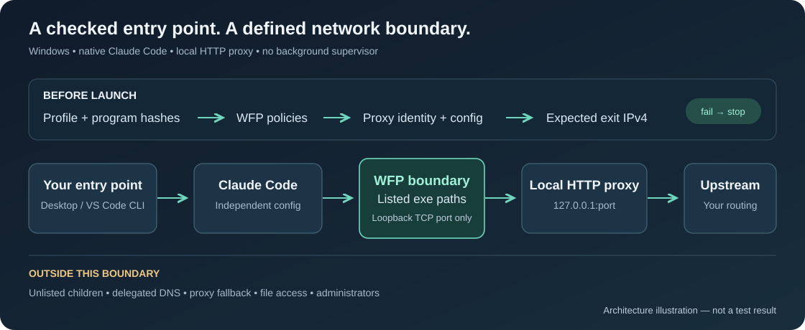
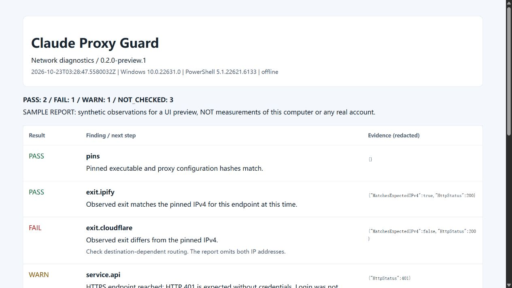

<div align="center">

# Claude Proxy Guard

**为 Windows Claude Code 提供固定代理、断线阻断和可验证诊断的一键启动工具。**

[](https://github.com/KardeniaPoyu/claude-proxy-guard/actions/workflows/windows.yml)
[](LICENSE)


[快速开始](#快速开始) · [操作手册](docs/usage.md) · [安全边界](docs/security-model.md) · [排错](docs/troubleshooting.md) · [English](README.en.md)

</div>

你已经有 Claude Code 和可用代理，希望每次开发都从同一个专用入口启动，代理不可用时让连接失败。Claude Proxy Guard 把**选节点、装连接限制、保存授权、建快捷方式和排错**串成一套 Windows 工作流程，可用于桌面快捷方式或 VS Code 集成终端。

启动前核验代理进程、配置文件和预期 IPv4；运行时，由 Windows Filtering Platform（WFP）限制已登记的 exe 只能连接指定本机 TCP 端口。导入的专用代理只保留选定节点，不携带 DIRECT 或自动切换组。**固定的是本机入口和导入配置；远端服务的路由仍需核验，出口检查不是持续监控。**

**当前为实验版。** 构建成功不等于网络隔离已验证；请查看[验证矩阵](docs/verification.md)。本项目不承诺“免封”，不是文件沙箱，与 Anthropic 无关联，也不分发 Claude Code 或代理节点。



## 核心差异

| 你需要的能力 | 本项目的做法 |
| --- | --- |
| 代理断开后阻断连接 | 环境变量告诉 CC 如何使用代理；WFP 持久规则负责阻断已登记 exe 的其他地址、端口、UDP 和 IPv6 连接 |
| 避免误用另一个代理 | 启动前核对实际监听进程、配置路径、文件 SHA-256、WFP 规则和预期 IPv4；检查失败就停止启动 |
| 复用已有节点，减少手填 | 从 NekoRay、Clash/Mihomo、v2rayN 的可读取本地核心配置中选一个节点，生成独立入口，不修改原客户端；不支持所有 GUI 数据库或订阅格式 |
| 独立开发入口 | 专用 `CLAUDE_CONFIG_DIR`、DPAPI 加密 token、桌面/VS Code 终端入口；默认禁用 MCP 和项目级设置来源，不设开机自启 |
| 能解释、能复现的诊断 | 分项检查出口和服务响应，导出脱敏报告；Windows CI 实测 WFP 阻断、代理停止与恢复，未检测的项目明确标注 |

通用代理客户端负责节点与路由，IP 检测网页展示浏览器观测结果；本项目把**启动检查与指定程序的连接限制**接在两者之间。它的价值在于这套流程的整合与可验证性，底层使用标准 WFP 和 DPAPI 技术。

## 适合哪些场景

| 使用场景 | 怎么用 |
| --- | --- |
| Windows 本机终端开发 | 用桌面快捷方式启动 CC，先检查专用代理，再加载自己的授权 |
| VS Code 中写项目 | 在[集成终端](docs/usage.md#vs-code-集成终端)使用同一启动器；可选择不同工作目录 |
| 已有 NekoRay / Clash / v2rayN 节点 | 用 `Setup.cmd` 自动发现本地核心配置，选择并导入一个节点 |
| 代理故障排查或提交 issue | 用 `Diagnose.cmd` 生成不含凭证、真实 IP 和私人路径的报告 |

## 使用前确认范围

- **仅支持 Windows 本机前台 CC 和 VS Code 集成终端。** VS Code 图形扩展、浏览器授权页、云端 CC、WSL 和共享后台会话不自动纳入保护。
- **规则按 exe 路径生效，不按父子进程继承。** Git、Python、MCP 等实际联网程序需要逐个配置；同一路径的其他实例也会受限。默认不启用 MCP。
- **DNS 和远端路由需另测。** Windows DNS 服务、浏览器 WebRTC、代理上游是否改走其他出口，不能仅凭 CC 的 WFP 规则证明。

[完整安全边界](docs/security-model.md) · [已验证与待验证项目](docs/verification.md)

## 一键诊断

**当前预览版：** [0.3.0-preview.1](https://github.com/KardeniaPoyu/claude-proxy-guard/releases/tag/v0.3.0-preview.1) 已包含 `Diagnose.cmd` 和 HTML/JSON 报告。

启动专用代理后，双击 **`Diagnose.cmd`**：核对两处 HTTPS 出口、探测 IPv6 出站、查看 Claude 网页/API 和更新源响应，并生成本地 HTML + JSON 报告。无须登录或提供 token，不停止现有代理。

```powershell
.\scripts\Test-Guard.ps1 -ExtendedNetwork -ExportReport -OpenReport
# 只检查本地状态，不访问检测站：
.\scripts\Test-Guard.ps1 -Offline -ExportReport
```

报告区分 **PASS / FAIL / WARN / NOT_CHECKED**，不导出真实 IP、私人路径、响应正文或凭证。DNS、WebRTC、断线直连没有实测时明确标为未检查；不把第三方评分或 HTTP 403 当成账号风险结论。详见[诊断操作说明与参考来源](docs/diagnostics.md)。



## 快速开始

### 1. 下载完整 ZIP

[Windows x64 ZIP](https://github.com/KardeniaPoyu/claude-proxy-guard/releases/download/v0.3.0-preview.1/claude-proxy-guard-0.3.0-preview.1-windows-x64.zip) · [SHA-256](https://github.com/KardeniaPoyu/claude-proxy-guard/releases/download/v0.3.0-preview.1/claude-proxy-guard-0.3.0-preview.1-windows-x64.zip.sha256)

从 [Releases](https://github.com/KardeniaPoyu/claude-proxy-guard/releases) 下载 `windows-x64.zip` 和对应 `.sha256`。不要把 GitHub 的 **Source code (zip)** 当安装包。

```powershell
Get-FileHash .\claude-proxy-guard-0.3.0-preview.1-windows-x64.zip -Algorithm SHA256
```

核对摘要后，在 ZIP 属性里点“解除锁定”（如显示），再解压到固定目录。预编译包未做代码签名；摘要只核对文件完整性。完整包已含 WFP helper 和 YAML 解析器，**普通使用者不需要安装 Visual Studio。**

- Windows 10/11、PowerShell 5.1 或更新版本，以及安装策略所需的管理员批准权限。
- 官方 Claude Code 原生 `claude.exe`；本项目不以共享 `node.exe` 作为入口。
- 已安装的 NekoRay、Clash/Mihomo 或 v2rayN，以及自己的有效节点。也可以手动接入现有专用 HTTP 代理。

<details>
<summary>开发者：从源码构建</summary>

需要 Visual Studio C++ Build Tools 与 Windows SDK。

在 **x64 Developer PowerShell for Visual Studio** 中执行：

```powershell
git clone https://github.com/KardeniaPoyu/claude-proxy-guard.git
cd claude-proxy-guard
.\scripts\Build.ps1
.\scripts\Restore-Dependencies.ps1
.\tests\Test-Static.ps1
```

</details>

之后使用普通权限 PowerShell 运行启动器。**不要以管理员权限启动 Claude。**

### 2. 运行配置向导

双击解压目录里的 **`Setup.cmd`**，第一个问题回车选择自动发现。也可在普通 PowerShell 中运行：

```powershell
.\scripts\Setup.ps1
```

按顺序：**选配置 → 选节点 → 确认内核 → 核对出口 IP → 安装规则 → 保存 token → 建快捷方式**。安装规则前关闭待限制的 Claude。原客户端可以继续运行。

找不到便携安装、需要导出节点或想了解凭证存放位置，见[自动发现教程](docs/client-discovery.md)。手动入口保留在向导的 `n` 选项，完整命令见[操作手册](docs/usage.md#创建配置与网络规则)。

没有 token 时，先跳过向导的保存步骤，运行 `Start-Guard.ps1 -SetupToken`，自己完成官方授权后再运行 `Save-Token.ps1`。授权用的外部浏览器不由本项目接管，见[保存授权](docs/usage.md#保存授权)。

配置默认保存在 `%LOCALAPPDATA%\ClaudeProxyGuard\default`，不要把这个目录提交到 Git。

### 3. 检查并启动

```powershell
.\scripts\Start-Guard.ps1 -CheckOnly
.\scripts\Start-Guard.ps1
```

`CheckOnly` 不启动 Claude，也不加载保存的 token。第一次使用前，应完成[网络验证](docs/verification.md)。

需要单独创建快捷方式：

```powershell
.\scripts\New-DesktopShortcut.ps1 -WorkingDirectory 'D:\Projects'
```

以后双击 **Claude Proxy Guard**。导入配置会按需启动专用代理，每次启动会请求 UAC 检查策略。不设开机自启；停止方法见[自动发现教程](docs/client-discovery.md#启动和停止)。VS Code 使用方法见[操作手册](docs/usage.md#vs-code-集成终端)。

## 遇到问题

| 现象 | 先看这里 |
| --- | --- |
| 代理未启动、出口不同、配置发生变化 | [启动检查失败](docs/troubleshooting.md#启动检查失败) |
| 启动后仍提示登录 | [授权问题](docs/troubleshooting.md#授权问题) |
| Git、Python、MCP 不能联网 | [工具范围](docs/usage.md#gitpython-和-mcp) |
| 更换代理、升级程序、换工作区 | [维护与更新](docs/usage.md#维护与更新) |
| 准备删除项目或恢复网络 | [卸载步骤](docs/usage.md#卸载) |

**先卸载策略，再删除配置。** WFP 策略是持久的，删文件或重启电脑不会自动移除它们：

```powershell
.\scripts\Remove-Policies.ps1
```

## 项目资料

- [架构与信任边界](docs/security-model.md) — 什么被检查，什么不在保护范围内。
- [客户端发现与节点导入](docs/client-discovery.md) — NekoRay、Clash/Mihomo、v2rayN 的支持范围和步骤。
- [验证矩阵](docs/verification.md) — 已有证据、待验证项目、可复现测试步骤。
- [FAQ](docs/faq.md) — 订阅、DNS、TUN、文件访问、云端 CC。
- [贡献指南](CONTRIBUTING.md) · [安全报告](SECURITY.md) · [更新记录](CHANGELOG.md)

欢迎提交可复现问题、测试报告和改进。请不要上传 token、完整代理配置、真实节点凭证或个人日志。[MIT License](LICENSE)。
